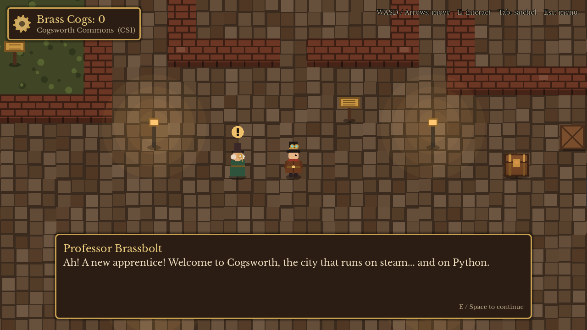
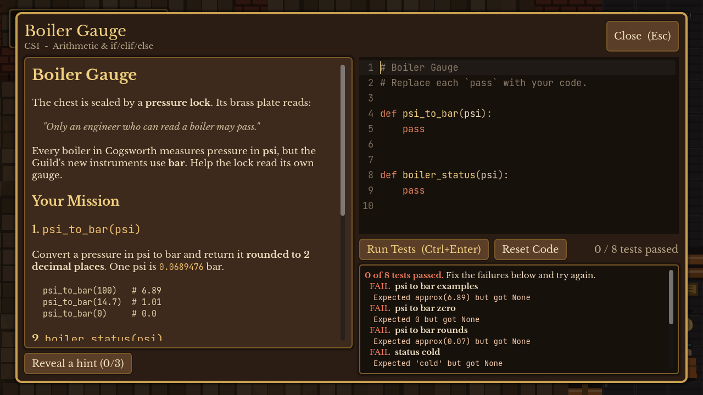

# Codepunk: The Clockwork Codex

A steampunk exploration game, built in **Godot 4**, that teaches **Python** to CS1 and CS2 students. It runs in the web browser, and student code runs in the browser too, with [Pyodide](https://pyodide.org). There's nothing for students to install.

Students explore the steam-powered city of Cogsworth. Every treasure chest and caged relic is sealed by a **puzzle-lock**: a programming problem with a set of tests. Make every test pass and the lock opens. You get the item, plus Brass Cogs that open gates to harder parts of the city.




## How it plays

| District | Level | Gate |
|---|---|---|
| **Cogsworth Commons** | CS1: arithmetic, `if`/`elif`, functions, strings, loops, lists, dictionaries, tuples, 2D grids | Open from the start |
| **Aetherforge Foundry** | CS2: classes, dunder methods, inheritance, stacks, linked lists, recursion, sorting algorithms | Foundry Gate: 6 cogs |
| **Vault of the Grand Engine** | CS2 finale: graphs and breadth-first search | Vault Door: 12 cogs |

* **Move:** WASD or arrow keys. **Interact:** E or Space. **Satchel:** Tab. **Menu:** Esc.
* In a puzzle-lock: the problem is on the left and a Python editor is on the right. **Ctrl+Enter** runs the tests.
* Each failing test says what went wrong, e.g. `Expected 'cold' but got None`. Errors and crashes highlight the line in the student's code that caused them.
* Every lock has 2–3 hints that the student can reveal one at a time.
* Code drafts, hints and progress save automatically. Solved locks can be reopened for practice.
* Students can skip a couple of CS1 locks and still reach the Foundry (6 of the 8 cogs are needed).

## Playing it

Once this is merged to `main` and GitHub Pages is turned on (**Settings → Pages → Source: GitHub Actions**), the included workflow builds and publishes the game at:

**https://irawoodring.github.io/codepunk/**

Students just open that link in a desktop browser (Chrome, Edge, Firefox or Safari). The first time they open a puzzle-lock, Python (about 10 MB) loads in the background. After that the browser caches it. Progress and code drafts save in the browser automatically.

The game is plain static files (`build/web/`), so you can host it on any web server, an LMS, or itch.io. It doesn't need any special server headers.

### Schools that block CDNs

Pyodide is loaded from jsDelivr by default. To host it yourself, copy a Pyodide 0.26.2 release folder to your server and add `?pyodide=<url-of-that-folder>/` to the game's URL, e.g. `https://example.edu/codepunk/?pyodide=https://example.edu/pyodide/`.

## Developing

1. Install [Godot 4.3+](https://godotengine.org/download) (the standard build).
2. Open `project.godot`.
3. To play exactly what students get, use the **Remote Debug → Run in Browser** button at the top right of the editor. This needs the web export templates (Godot offers to download them). That runs with Pyodide.
4. Pressing plain **Play (F5)** runs a desktop window, which has no browser and so no Pyodide. In that mode the game uses your computer's Python 3 if it has one, purely as a convenience for writing challenges. Students never need it.

To build the web version yourself: **Project → Export → Web → Export Project**, or

```sh
godot --headless --path . --export-release "Web" build/web/index.html
```

## How student code is tested

`python/harness.py` runs the student's `mymodule.py` against the challenge's `test_mymodule.py`:

* In the browser it runs inside **Pyodide in a Web Worker** (`web/codepunk_python.js`). If code runs longer than **10 seconds** (an infinite loop, say), the worker is stopped and a fresh one started, so the game never freezes.
* No pytest is needed. A built-in shim provides `pytest.approx`, `pytest.raises`, `pytest.fail` and `@pytest.mark.parametrize`.
* `assert a == b` failures are rewritten into `Expected b but got a` messages.
* Syntax errors, import errors, crashes, `RecursionError` and `input()` calls are turned into plain-English messages with line numbers.
* Student code never leaves the student's computer.

## Adding or changing challenges

Each challenge is a folder in `challenges/`, in the same layout as Laker Code Gym problems:

```
challenges/boiler_gauge/
  meta.json          # title, tier, topic, cogs, reward item, hints
  readme.md          # problem description shown in-game (Markdown)
  mymodule.py        # starter code: include a stub for every function!
  test_mymodule.py   # pytest-style tests
```

`meta.json`:

```json
{
  "title": "Boiler Gauge",
  "tier": "CS1",
  "topic": "Arithmetic & if/elif/else",
  "cogs": 1,
  "reward": {"item": "Pressure Gauge", "description": "Flavour text...", "color": "#d4a64a"},
  "hints": ["First nudge", "Bigger hint", "Nearly the answer"]
}
```

Add `"final": true` to the challenge that wins the game.

To import a problem from the practice site:

```sh
python tools/import_problem.py ../code_practice_site/problems/tip_calculator --tier CS1
```

To check everything (each starter loads and fails, and each challenge is on the map), optionally with reference solutions kept **outside this repo** as `<challenge_id>.py`:

```sh
python tools/check_challenges.py
python tools/check_challenges.py --solutions ~/codepunk-solutions
```

## Editing the world

The map is ASCII art in `world/map.json` (`rows`). Each character is a 32×32 tile:

| Char | Tile | Char | Tile |
|---|---|---|---|
| `#` | brick wall (solid) | `.` | cobblestone |
| `W` | canal water (solid) | `,` | moss |
| `P` | copper pipes (solid) | `=` | foundry grate |
| `X` | crate (solid) | `-` | rail track |
| `L` | lamp post (solid) | `~` | steam vent |
| `@` | player start | `1`–`9` | gates, defined in `gates` with the cogs they need |

Lowercase letters are objects defined in `legend`:

```json
"a": {"type": "chest",  "challenge": "boiler_gauge"},
"b": {"type": "relic",  "challenge": "gear_ratio"},
"o": {"type": "engine", "challenge": "steam_network"},
"p": {"type": "npc", "name": "Professor Brassbolt", "style": "professor", "lines": ["..."]},
"s": {"type": "sign", "text": "COGSWORTH PLAZA"}
```

`districts` sets the name and tier shown in the HUD for each column range of the map.

## Project layout

```
project.godot, scenes/main.tscn   entry point (the scene is built in code)
scripts/
  main.gd                 wires world, player, objects and UI together
  world.gd, ambient.gd    tile map drawing/collision, steam and lamp effects
  player.gd               movement and interaction
  interactable.gd         chests, relics, the engine, gates, NPCs, signs
  game_state.gd           progress, inventory, drafts, saving (autoload)
  challenge_library.gd    loads challenges (autoload)
  python_runner.gd        runs tests via Pyodide (web) or local Python (editor) (autoload)
  steam.gd, markdown.gd   palette/theme/drawing helpers, Markdown -> BBCode
  ui/                     HUD, dialog box, challenge panel, satchel, menus
python/harness.py         test runner (Pyodide or CPython; no pytest needed)
challenges/               the 15 puzzle-locks
world/map.json            the city
tools/                    challenge checker and importer
web/codepunk_python.js    Pyodide bridge (runs Python in a Web Worker)
fonts/                    Libre Baskerville and JetBrains Mono (SIL Open Font License)
tests/                    end-to-end tests of the real game
.github/workflows/        builds the web version and publishes it to GitHub Pages
```

All art is drawn in code, so there are no image assets to manage.

## Testing

The GitHub workflow runs these, checks every challenge, and builds the web export on every push and pull request.

```sh
# Choosing New Game from the title screen starts a fresh game.
godot --headless --path . res://tests/new_game_test.tscn
# End-to-end: opens a chest, runs Python tests, opens a gate, checks saving.
# (Runs in the desktop window, so it uses local Python 3.)
godot --path . res://tests/smoke_test.tscn
# ...and save screenshots of each step:
godot --path . res://tests/smoke_test.tscn -- --shots=/tmp/shots
```

## Ideas for next steps

* More districts (e.g. an **Airship Docks** for file I/O and exceptions, or an **Observatory** for dictionaries of dictionaries and complexity).
* Per-test "partial credit" visuals, like gears on the lock that turn as more tests pass.
* A teacher export of student progress (the browser save already has everything).
* Mobile/tablet support (an on-screen joystick and keyboard).
